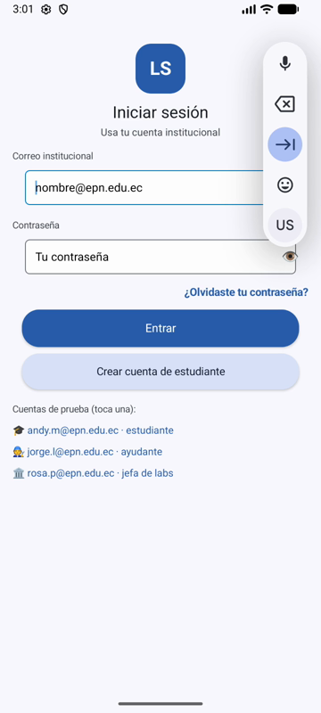
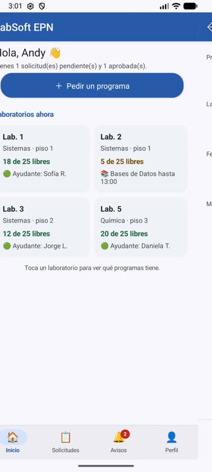
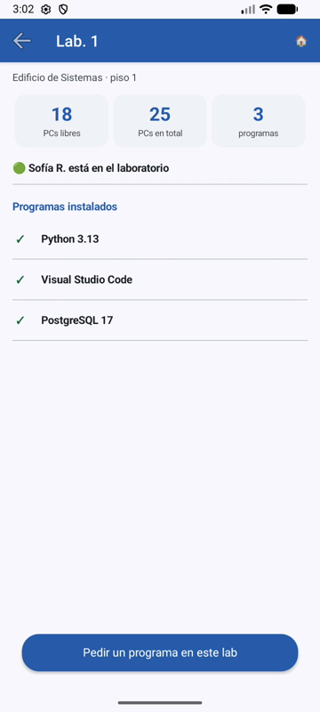
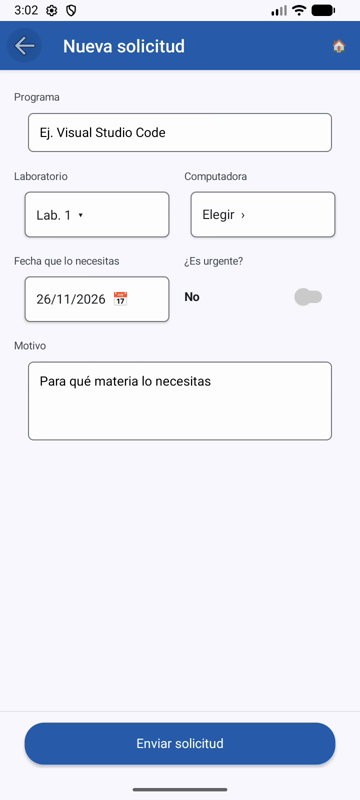
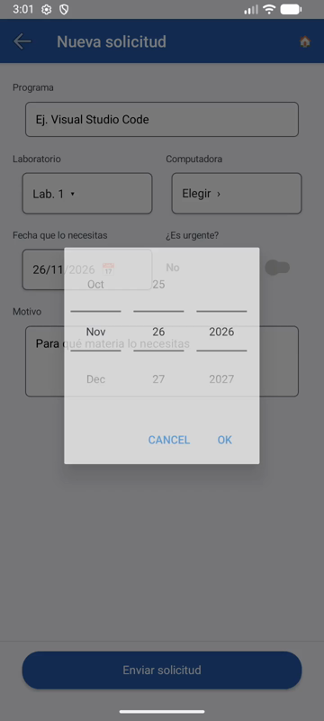
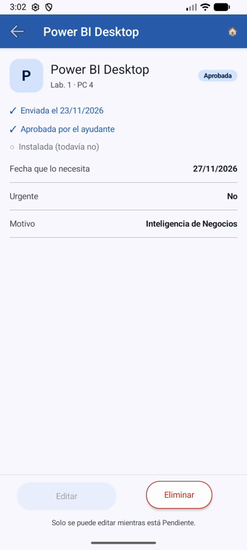
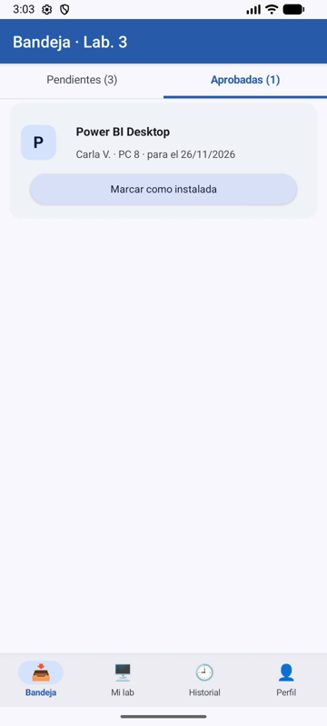
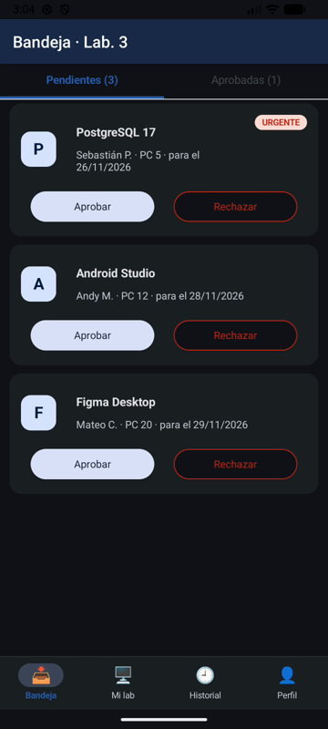
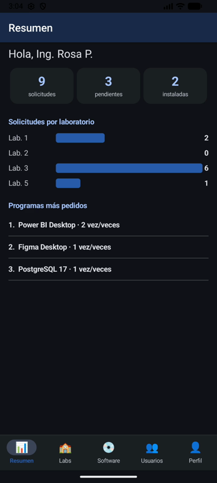
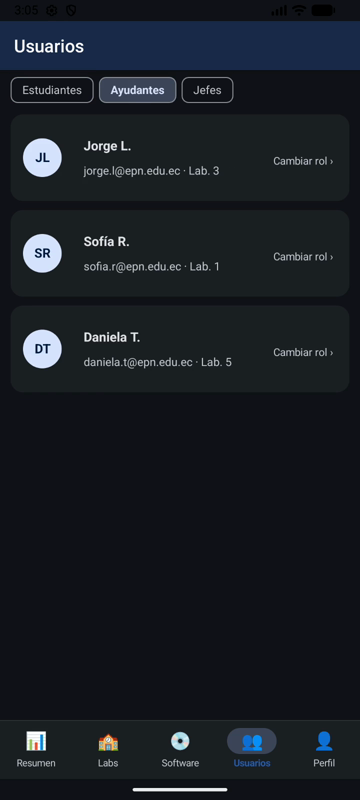

# LabSoft EPN · Interfaces de la aplicación móvil (T.05)

> **Trabajo en clase T.05 · Aplicaciones Móviles · Escuela Politécnica Nacional**
> Interfaces de usuario de la app **LabSoft EPN**, hechas en **NativeScript 9 + TypeScript** y ejecutadas en un emulador Android.
>
> ✏️ **Autor(es):** Maldonado Shirley · **Fecha:** 28 noviembre de 2026

---

## 1. Objetivo

Diseñar e implementar **todas las interfaces de usuario** de LabSoft EPN como pantallas reales de una app Android, a partir de los bocetos de baja fidelidad hechos en el taller "De la servilleta a la IA". Cada pantalla usa los **componentes visuales nativos** que corresponden al diseño: lista, tarjeta, formulario, interruptor, calendario, diálogo, Toast y menú inferior.

En esta entrega **lo importante son las interfaces**: cómo se ve cada pantalla y cómo se pasa de una a otra.

## 2. El problema que resuelve la app

En los laboratorios de la EPN, los estudiantes no pueden instalar programas en las computadoras porque hace falta la **contraseña de administrador**, que solo tiene el ayudante. Hoy, para pedir un programa hay que buscar al ayudante en persona y esperar. Muchas veces el estudiante no sabe si el programa ya está instalado en otro laboratorio.

**LabSoft EPN** hace que pedir software sea como pedir comida a domicilio: eliges el programa, el laboratorio y la computadora, y la app te avisa cuando el ayudante lo aprueba y lo instala.

## 3. ¿Qué hace la aplicación?

La app tiene **3 tipos de usuario**, y cada uno ve su propio menú inferior:

| Usuario | Qué puede hacer |
|---|---|
| 🎓 **Estudiante** | Ver los laboratorios (PCs libres, ayudante presente, programas instalados), pedir un programa eligiendo laboratorio, computadora y fecha, seguir el estado de sus solicitudes y recibir avisos. |
| 🧑‍🔧 **Ayudante de laboratorio** | Revisar la bandeja de solicitudes de su laboratorio, aprobarlas o rechazarlas con un motivo, marcarlas como instaladas y actualizar el estado del laboratorio. |
| 🏛 **Jefa de laboratorios** | Ver un resumen con estadísticas, administrar laboratorios, el catálogo de software y los roles de los usuarios, y descargar un reporte. |

## 4. Pantallas implementadas (34)

| Código | Pantalla | Componentes principales |
|---|---|---|
| **C1** | Carga (splash) | Logo + `ActivityIndicator` |
| **C2** | Iniciar sesión | `TextField` (correo y contraseña con ojo para mostrarla), `Button` |
| **C3** | Recuperar contraseña | `TextField` + Toast |
| **C4** | Cerrar sesión | `AlertDialog` de confirmación |
| **R1** | Registro · datos personales | 5 `TextField` con validación en rojo, `Progress` (paso 1 de 3) |
| **R2** | Registro · carrera y código único | Menús de facultad, carrera y semestre; `ActivityIndicator` "Consultando…" |
| **R3** | Error de validación | `AlertDialog` de un botón **CORREGIR** |
| **R4** | Verificar correo | Campo de 6 números + cuenta regresiva para reenviar |
| **E1** | Inicio del estudiante | Tarjetas de laboratorios en 2 columnas + menú inferior |
| **E2** | Detalle del laboratorio | 3 cifras grandes + `ListView` de programas instalados |
| **E3** | Mis solicitudes | Chips de filtro + `ListView` de tarjetas + botón flotante **+** |
| **E4** | Detalle de solicitud | Línea de pasos (enviada → aprobada → instalada) |
| **E5 / E6** | Nueva / editar solicitud | Formulario en **una sola pantalla**, sin desplazarse |
| **E5b** | Calendario | `DatePickerDialog` nativo de Android |
| **E5d** | Elegir computadora | Plano del aula con 25 botones (libre / ocupada / elegida) |
| **E7 / E8** | ¿Eliminar? + Toast | `AlertDialog` + `Toast` nativos |
| **E9** | Avisos | `ListView` con insignia roja de no leídos |
| **E10** | Perfil | Datos del usuario + `Switch` de notificaciones y **modo oscuro** |
| **A1** | Bandeja del ayudante | Pestañas Pendientes / Aprobadas, botones Aprobar / Rechazar |
| **A2** | Revisar solicitud | Detalle con acciones del ayudante |
| **A3** | Aprobación con deshacer | Snackbar con **DESHACER** durante 4 segundos |
| **A4** | Rechazar | `AlertDialog` con un campo de texto para el motivo |
| **A5** | Mi laboratorio | `Switch` "Estoy en el laboratorio", contador − / +, mantenimiento |
| **A6** | Historial | Solicitudes instaladas y rechazadas |
| **AD1** | Resumen | Cifras grandes + gráfico de barras por laboratorio + top de programas |
| **AD2 / AD3** | Laboratorios / formulario de laboratorio | Lista + botón **+**; formulario con contador de PCs |
| **AD4 / AD5** | Software / formulario de programa | Lista con `Switch` de "permitido"; chips de selección múltiple |
| **AD6 / AD7** | Usuarios / cambiar rol | Chips por rol + `AlertDialog` con opciones de radio |
| **AD8** | Perfil de la jefa | Botón **Descargar reporte** |

## 5. Capturas

| | | | | |
|:-:|:-:|:-:|:-:|:-:|
|  |  |  |  |  |
| C2 Login | E1 Inicio | E2 Laboratorio | E5 Nueva solicitud | E5b Calendario |
|  |  |  |  |  |
| E4 Detalle | A1 Bandeja | A1 en modo oscuro | AD1 Resumen | AD6 Usuarios |

## 6. Video de demostración

🎬 [**Ver el video de las interfaces**](video/LabSoft_Interfaces.mp4) (2 min 28 s)

El video recorre las pantallas de los 3 usuarios, en este orden:
1. Carga y login.
2. Estudiante: inicio, laboratorio, nueva solicitud, elegir PC, calendario, mis solicitudes, detalle, avisos y perfil.
3. Ayudante: bandeja, revisar, historial, mi laboratorio y modo oscuro.
4. Jefa: resumen, laboratorios, formulario de laboratorio, nuevo programa, usuarios y perfil.

## 7. Navegación

- **Menú inferior** con 4 o 5 botones según el usuario. Es el `BottomNavigationView` de Android.
- **Flecha ← atrás** en las pantallas internas y botón **🏠** para volver directo al inicio.
- El **botón atrás del celular** también funciona: en una pestaña que no es la primera, regresa al inicio en vez de cerrar la app.

```
C1 Carga → C2 Login ─┬─ Estudiante: E1 Inicio · E3 Solicitudes · E9 Avisos · E10 Perfil
                     ├─ Ayudante:   A1 Bandeja · A5 Mi lab · A6 Historial · Perfil
                     ├─ Jefa:       AD1 Resumen · AD2 Labs · AD4 Software · AD6 Usuarios · AD8 Perfil
                     └─ Crear cuenta: R1 → R2 (R3 si hay error) → R4 → E1
```

## 8. ¿Por qué NativeScript?

NativeScript dibuja **componentes nativos reales de Android**, no una página web. Por ejemplo:

| En el código (NativeScript) | Lo que dibuja Android |
|---|---|
| `<ListView>` | `RecyclerView` |
| `<TextField>` | `EditText` |
| `<Switch>` | `SwitchMaterial` |
| `<ActionBar>` | `Toolbar` |
| `android.app.AlertDialog.Builder` (llamado desde TypeScript) | Diálogo nativo |
| `android.widget.Toast` | Toast nativo |
| `android.app.DatePickerDialog` | Calendario nativo |

Esto se puede comprobar en Android Studio con **Tools → Layout Inspector**.

## 9. Estructura del proyecto

```
app/
├── app.ts / app-root.xml / app.css   ← arranque, primera pantalla y estilos (incluye modo oscuro)
├── entrada/      C1 carga · C2 login · C3 recuperar
├── registro/     R1 datos · R2 carrera (+R3) · R4 verificar
├── estudiante/   E1 inicio · E2 lab · E3 solicitudes · E4 detalle · E5/E6 formulario · E5d computadoras · E9 avisos
├── ayudante/     A1 bandeja (+A3, A4) · A5 mi lab · A6 historial
├── jefe/         AD1 resumen · AD2/AD3 labs · AD4/AD5 software · AD6/AD7 usuarios
├── comun/        perfil (E10 / AD8 / C4) · ui.ts (menú inferior, ←, 🏠, modo oscuro)
├── nativo/       dialogos.ts (AlertDialog, DatePickerDialog, Toast)
└── datos/        store.ts (datos de ejemplo en memoria)
```

Cada pantalla tiene un `.xml`, que dice **cómo se ve**, y un `.ts`, que dice **qué pasa al tocar**.

## 10. Cómo ejecutarlo

Requisitos: Node.js, NativeScript CLI 9, Android Studio con un emulador (probado en *Medium Phone API 37*).

```bash
npm install
ns run android        # en Windows PowerShell usar: ns.cmd run android
```

**Cuentas de prueba** (cualquier contraseña de 4 o más caracteres):

| Correo | Rol |
|---|---|
| andy.m@epn.edu.ec | Estudiante |
| jorge.l@epn.edu.ec | Ayudante (Lab. 3) |
| rosa.p@epn.edu.ec | Jefa de laboratorios |

